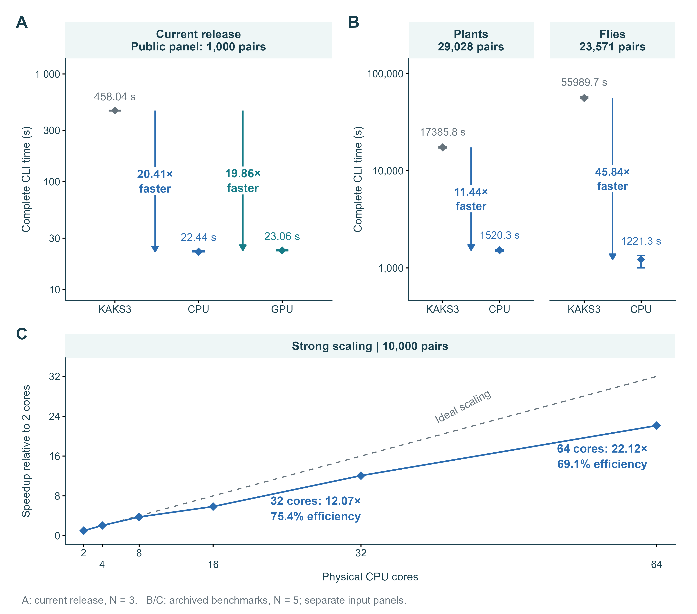

<div align="center">

# KaKsTurbo

### 面向比较基因组学的高性能 Ka/Ks 估计

[](docs/METHODS.md)
[](docs/METHODS.md)
[](docs/METHODS.md#complete-model-averaging)
[](LICENSE)

**[下载](https://github.com/707728642li/KaKsTurbo/releases/tag/v1.1.0rc10) · [快速入门](QUICKSTART_ZH.md) · [批量 CDS 教程](docs/RAW_CDS_TUTORIAL_ZH.md) · [English](README.md)**

</div>

> 此 1.1.0 源码标签用于准备 Bioconda 构建。当前已发布的 PyPI 和便携下载包仍为文档所列候选版本；Bioconda 上线须经审核。

KaKsTurbo 从密码子比对后的同源基因序列估计非同义替换率 **Ka**、同义替换率 **Ks** 及其比值 **Ka/Ks**。软件结合**完整十四模型平均、结构化 FP64 矩阵计算与边界约束优化**，通过 CPU 并行与 GPU 批量执行支撑比较基因组学分析；两个后端共享模型定义与数值策略。

结果同时保留候选模型权重、优化诊断及不可用估计的具体原因。**断点恢复与标准 TSV/JSONL 输出**便于批量分析和下游集成；[CDS/PEP 教程](docs/RAW_CDS_TUTORIAL_ZH.md)覆盖原始序列比对、输入整理与 Ka/Ks 计算的完整流程。

## 计算流程与方法

[](docs/assets/workflow.png)

**流程概览。** 密码子比对后的基因对依次经过似然计算、边界约束优化与完整模型平均。计算保留全部 61 个有义密码子状态；图中的权重与可行域为示意。延长拟合用于独立验证，默认 CLI 运行不自动执行这一过程。

- **结构化矩阵计算：** 利用生成矩阵及导数结构，保留完整均值速率导数和经过检查的回退路径。
- **边界约束优化：** CPU/GPU 共用有界 BFGS 与 Schur 自由坐标修正，配合线搜索和方向保护。
- **完整模型平均：** 保留全部十四候选，通过 AICc 权重平均参数、重建一个 GTR 过程后再计算 Ka/Ks。
- **可检查的数值状态：** 输出模型权重、边界/封顶标记、投影梯度和 NA 原因。

候选模型家族与 MA 框架沿用已有 KaKs 方法。KaKsTurbo 的工作重点是结构化数值计算、边界约束优化及其 CPU/GPU 实现，并通过明确的诊断与验证记录说明结果的数值状态。[方法说明](docs/METHODS.md) · [数值验证](docs/NUMERICAL_VALIDATION.md)

## 性能与并行扩展

[](docs/assets/performance.png)

**A：N=3；B/C：N=5 技术重复。** 菱形为中位数，耗时误差条为最小—最大值；KAKS3 为 KaKs_Calculator 3.0 MA。

| 数据与执行环境 | N | 基线耗时 | CPU 耗时 | GPU 耗时 | 中位数耗时之比 |
|:---|---:|---:|---:|---:|:---|
| 公共 1,000 对，同一 Windows 主机 | 3 | 458.04 s | **22.44 s** | **23.06 s** | CPU **20.41×**；GPU **19.86×** |
| 植物 29,028 对，归档 Linux CPU 实验 | 5 | 17,385.79 s | **1,520.30 s** | — | CPU **11.44×** |
| 果蝇 23,571 对，归档 Linux CPU 实验 | 5 | 55,989.67 s | **1,221.29 s** | — | CPU **45.84×** |

以上比较每臂分配 **8 个物理核 / 16 个逻辑处理器**；GPU 臂额外使用一张 GPU。Linux 队列采用独立 CPU 亲和性并发，仍共享主机带宽和存储。另一个固定 10,000 对数据集上，64 物理核相对 2 核为 **22.12×、69.1% 并行效率**。

加速比取**端到端 CLI 耗时中位数之比**，适用于表中工作负载与执行条件，并包含相对基线的估计策略差异。GPU 比较限于同机 1,000 对主基准，该组 CPU 略快于 GPU。[完整协议、全部观测与局限](docs/PERFORMANCE.md)

## 下载与安装

### PyPI

在已有 Python 环境中安装：

```bash
python -m pip install --only-binary=:all: kaksturbo==1.1.0rc10
kaksturbo doctor --backend cpu
```

要求 Python ≥3.11，以及 Linux x86-64/glibc ≥2.17 或 Windows x86-64。CPU 计算无需 CUDA。[安装与验收说明](docs/PACKAGE_INDEX.md)

### 便携包

完整解压后即可运行，核心 CPU 计算无需另外安装 Python、Conda 或 CUDA。

| 平台 | 当前程序版本 | 下载 |
|:---|:---|:---|
| Linux x86-64，glibc ≥2.17 | 1.1.0rc9-tutorial1 | [TAR.GZ](https://github.com/707728642li/KaKsTurbo/releases/download/v1.1.0rc10/KaKsTurbo-1.1.0rc9-tutorial1-docs2-linux-x86_64.tar.gz) |
| Windows x86-64 | 1.1.0rc10 | [ZIP](https://github.com/707728642li/KaKsTurbo/releases/download/v1.1.0rc10/KaKsTurbo-1.1.0rc10-docs2-windows-x86_64.zip) · [长路径解压器](https://github.com/707728642li/KaKsTurbo/releases/download/v1.1.0rc10/Install-KaKsTurbo.ps1) |

[校验值](https://github.com/707728642li/KaKsTurbo/releases/download/v1.1.0rc10/SHA256SUMS-docs2.txt) · [已验证平台](docs/LINUX_COMPATIBILITY.md) · [Windows 路径说明](docs/WINDOWS_PATHS_ZH.md)

<details>
<summary><strong>版本与离线文档说明</strong></summary>

当前下载为预发布版。Windows rc10 包含已验收的路径处理改进；Linux 便携包保留单独验收的 rc9-tutorial1 构建。PyPI 在两个平台均提供 **1.1.0rc10**。源码仓库用于开发。

`docs2` 表示文档打包修订，包含随包 README、中英文教程、方法/性能图和合成结果预览，可离线阅读。程序版本见上表，旧包继续保留在同一个 Release。

</details>

**Bioconda：**[配方](https://github.com/bioconda/bioconda-recipes/pull/70404)尚待审核与官方频道上架，当前可通过 PyPI 或上述便携包安装。

## 快速运行

以下示例使用便携包。通过 PyPI 安装时，请参见[已安装命令的快速入门](docs/PACKAGE_INDEX.md#quick-start-with-the-installed-command)。

已有密码子比对数据时，在 Linux 解压目录执行：

```bash
./kaksturbo doctor --backend cpu
./kaksturbo run --input examples/three_pair_smoke.axt \
  --output results_demo --backend cpu --threads 8
head -n 4 results_demo/result.tsv
```

用自己的 AXT 替换示例输入即可；FASTA 需要 `--pairs` 指定有向配对。使用新的输出目录。[完整快速入门](QUICKSTART_ZH.md) · [输入输出说明](docs/INPUT_OUTPUT.md)

如果只有原始 CDS/PEP 和同源配对列表，按[批量教程](docs/RAW_CDS_TUTORIAL_ZH.md)先完成比对。主程序不推断同源关系或自动修复移码。

### GPU 与模式选择

`robust` 是默认 CPU/GPU 模式；`reproduce` 为历史 CPU 估计策略，用于兼容性工作，两者数值策略不同。`--backend auto` 当前选择 CPU。显式 GPU 运行前执行：

```bash
nvidia-smi
./kaksturbo doctor --backend gpu --probe-gpu
./kaksturbo run --input examples/three_pair_smoke.axt \
  --output gpu_result --backend gpu --device cuda:0
```

GPU 后端要求 NVIDIA 计算能力 ≥8.6、驱动 CUDA 兼容级别 ≥12.9、至少 8 GiB 空闲显存（含余量）；无需单独安装 CUDA Toolkit。设备、驱动或显存不满足时明确提示原因，不静默切换 CPU。[设备说明](docs/DEVICE_GUIDE_ZH.txt)

## 标准结果与数值诊断

以下是内置合成输入的真实 Windows CPU 结果，选取部分列并显示六位小数。Linux 尾数可能略有不同。

| pair_id | Ka | Ks | Ka_Ks | status |
|:---|---:|---:|---:|:---|
| forward | 0.066008 | 0.065604 | 1.006154 | available |
| reverse | 0.066008 | 0.065604 | 1.006154 | available |
| identical | NA | NA | NA | unidentifiable |

[完整精度 TSV](examples/results/three_pair_cpu.tsv) · [JSONL](examples/results/three_pair_cpu.jsonl) · [质量摘要](examples/results/three_pair_cpu_quality.txt)

完全相同的序列对无法确定 Ka/Ks 比值，保留 **NA** 与具体原因。标准结果还包含序列 ID、密码子数、模型和诊断信息；`available` 表示结果可构建，收敛状态需结合数值诊断判断。

| 输出文件 | 用途 |
|:---|:---|
| `result.tsv`、`results.jsonl` | 用于下游分析的核心结果 |
| `models.tsv`、`models.jsonl` | 候选模型拟合、权重与诊断 |
| `pair_statistics.jsonl`、`qc.tsv` | 保留密码子统计与输入质控 |
| `quality_summary.txt`、`quality_summary.json` | 有限值/NA 覆盖、边界、封顶与梯度标记 |

可选兼容导出生成 KaKs_Calculator 风格的 22 列结果表，缺失或未验证的统计量为 NA，并说明原因。该导出保留标准结果，格式兼容不代表估计器等价。[字段映射与读取示例](docs/COMPATIBLE_EXPORT_ZH.txt)

## 批量流程集成

- **终端进度：** 显示已提交对数、吞吐、耗时、预计剩余时间及处理阶段。
- **断点恢复：** `status results_demo` 查询状态，`resume results_demo` 继续兼容的中断任务。
- **机器可读输出：** `--json` 提供结构化命令输出，`--quiet` 隐藏进度；默认不生成 HTML。
- **输入可追溯性：** 有向基因对 ID、请求顺序、输入哈希及预处理元数据与结果关联。

## 更多文档

- [中文 CLI/API 使用说明](USER_GUIDE_ZH.txt)；[英文 CLI 参考](docs/USAGE.md)。
- [Linux 已验证平台](docs/LINUX_COMPATIBILITY.md)；[Windows 长路径](docs/WINDOWS_PATHS_ZH.md)。
- [数值验证和未解决项](docs/NUMERICAL_VALIDATION.md)；[版本与断点恢复](docs/MIGRATION.md)。
- [兼容导出字段](docs/COMPATIBLE_EXPORT_ZH.txt)；[原始 CDS 批量教程](docs/RAW_CDS_TUTORIAL_ZH.md)。

## 适用范围与结果解读

支持范围为**标准遗传密码表 1 下的 MA**。有限坐标验收、投影梯度诊断与独立参考拟合提供不同层面的数值证据。CPU/GPU 的拟合端点可能略有差异，有限结果不代表全局最优；**Ka/Ks >1 本身不是正选择显著性检验**。NA 状态与诊断标记随结果保留，已知未解决项见[验证说明](docs/NUMERICAL_VALIDATION.md)。

维护者：**Taishan Li** · **litaishan@caf.ac.cn**。许可：[GPL-3.0-only](LICENSE)。引用请注明软件版本和 Release URL；[CITATION.cff](CITATION.cff) 提供机器可读元数据。问题反馈请通过 [GitHub Issues](https://github.com/707728642li/KaKsTurbo/issues)，使用最小合成示例。
